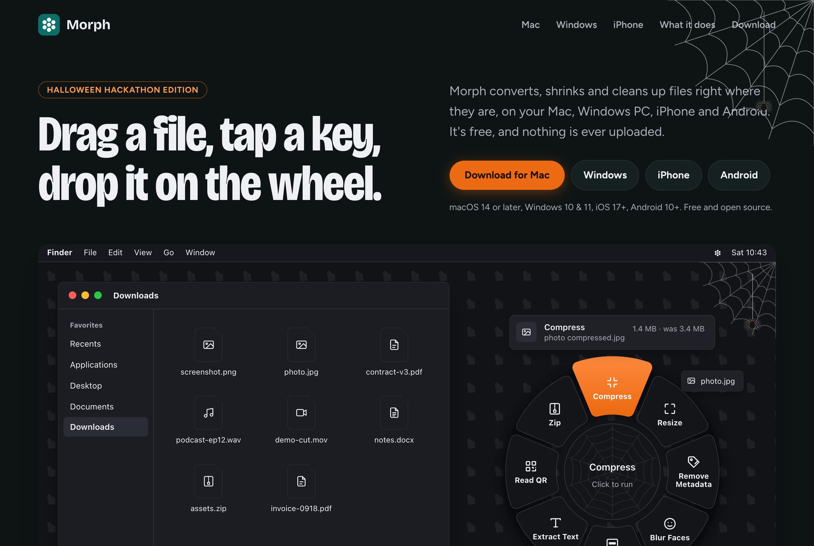
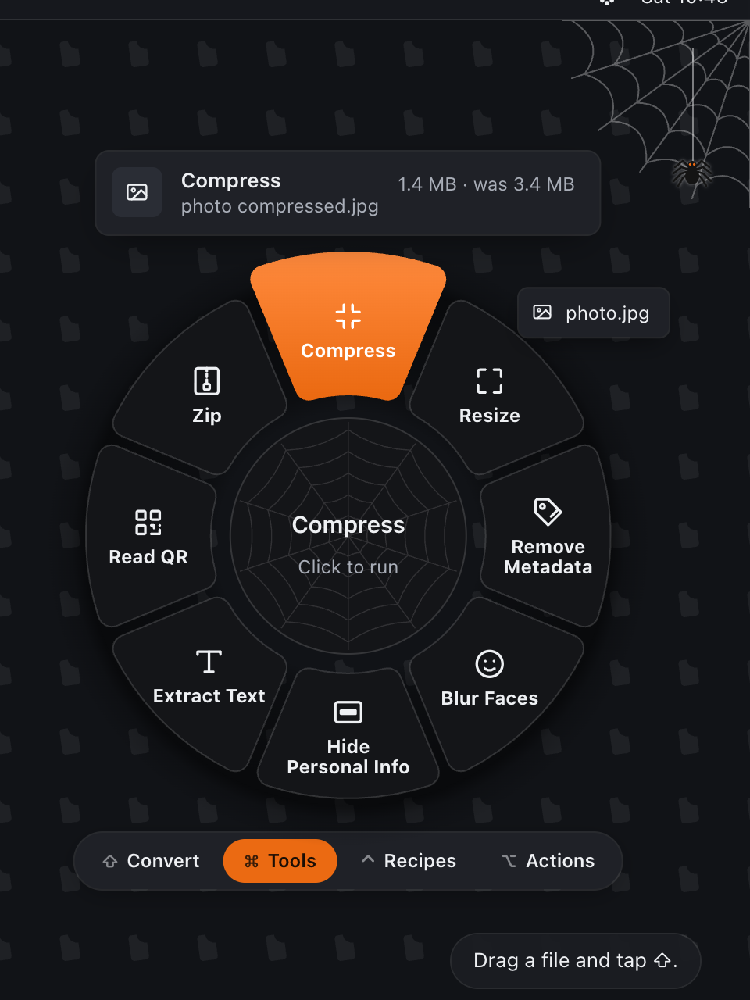
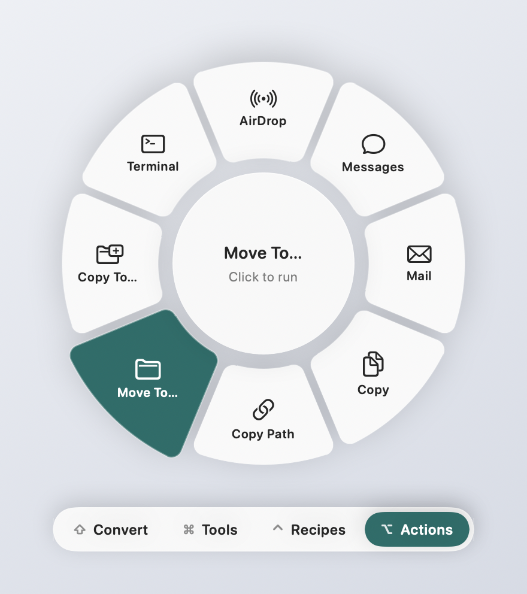
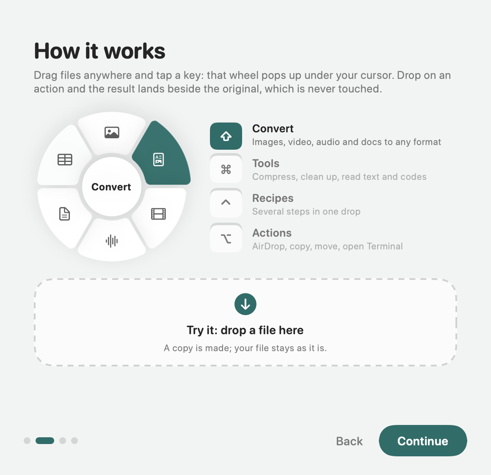
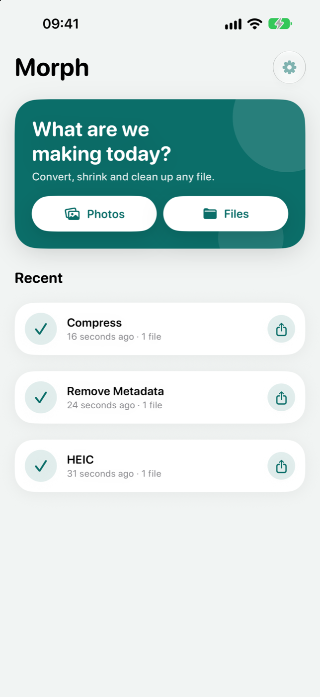
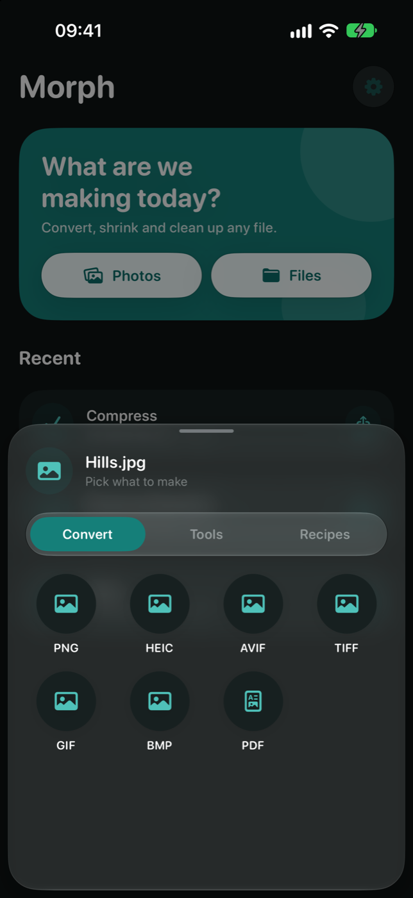
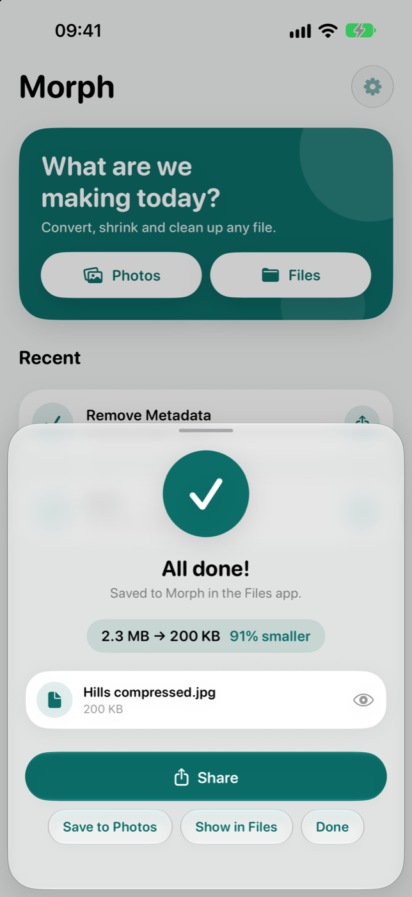

# Spooky Morph

**Drag a file, tap a key, drop it on the wheel.** [spooky-morph.vercel.app](https://spooky-morph.vercel.app)

Morph is a free file converter and toolbox for macOS, Windows, iOS and Android. It shows only the actions that make sense for the files you give it: convert them, compress them, strip their metadata, pull the text out of them and more. Everything runs on your device; nothing is uploaded.

<p>
  
  
</p>

## What's spooky

This is the Halloween edition of [Morph](https://github.com/geetxnshgoyal/morph). The file converter itself was already built; this repo adds:

**In the Mac app**, pick the **Pumpkin** color in Settings and the wheel changes with it:
- An orange wheel, with near-black labels so they stay readable
- A cobweb in the corner of the wheel, with a spider letting itself down on a thread
- Spooky sounds, all synthesized in the app: a hollow creak, a ghostly "wooo" and a low groan

**On the [website](https://spooky-morph.vercel.app)**, on every page:
- Pumpkin orange on a dark canvas, with the product screenshots tinted to match
- On the homepage, cobwebs with spiders on threads, a web in the demo wheel's hub, and a wheel that asks "Trick or treat?"

## Download

Grab a build from [Releases](https://github.com/geetxnshgoyal/morph/releases/latest):

| Platform | File | Needs |
| --- | --- | --- |
| macOS | [`Morph-1.0.0.dmg`](https://github.com/geetxnshgoyal/morph/releases/download/v1.0.0/Morph-1.0.0.dmg) | macOS 14 or later, Apple Silicon or Intel |
| Windows | [Microsoft Store](https://apps.microsoft.com/detail/9PHWJVRC85DW), or [`Morph-1.0.1-x64-setup.exe`](https://github.com/geetxnshgoyal/morph/releases/download/v1.0.0/Morph-1.0.1-x64-setup.exe) ([`arm64`](https://github.com/geetxnshgoyal/morph/releases/download/v1.0.0/Morph-1.0.1-arm64-setup.exe) for Arm PCs) | Windows 10 version 1809 or later, or Windows 11 |
| Android | [`Morph-1.0.0.apk`](https://github.com/geetxnshgoyal/morph/releases/download/v1.0.0/Morph-1.0.0.apk) | Android 10 or later |
| iOS | build it with Xcode, see [ios/README.md](ios/README.md) | iOS 17 or later |

**macOS:** open the DMG and drag Morph into Applications. The build is signed with a Developer ID and notarized by Apple. These downloads are Morph 1.0.0, from before the Pumpkin color. To get Pumpkin, build the Mac app from this repo: `scripts/bundle.sh --install`.

**Windows:** get Morph from the [Microsoft Store](https://apps.microsoft.com/detail/9PHWJVRC85DW), or run the setup file. It installs for your user only, with no admin prompt. The installer isn't code-signed yet, so SmartScreen may say it doesn't recognise the app: click **More info**, then **Run anyway**. Morph then sits in the taskbar corner; see [windows/README.md](windows/README.md).

**Android:** download the APK, open it on your phone, and allow installs from that source when Android asks.

## The Mac app

Morph lives in the menu bar. While you drag files anywhere (Finder, the desktop, any app), tap a wheel's keys and that wheel opens right under the cursor. Drop the files on an action and the result appears next to the original.

| Keys | Wheel | What's on it |
| --- | --- | --- |
| ⇧ | Convert | Every format the files can become |
| ⌘ | Tools | Compress, resize, remove metadata, blur faces, extract text, read QR codes, merge PDFs, zip |
| ⌃ | Recipes | Several steps in one drop, like "Web Image" or "Under 1 MB" |
| ⌥ | Actions | AirDrop, Messages, Mail, Copy, Copy Path, Move To…, Copy To…, open Terminal there |

- A tap is enough: the wheel stays open after you let go of the key. Tap another wheel's keys to switch, or press Esc to close.
- Every wheel's keys can be changed in Settings, to a single key or a combination such as ⌃⇧.
- Hover moves a highlight around the ring with a soft tick; arrow keys, the scroll wheel and Tab work too.
- The wheel uses Liquid Glass on macOS 26 and follows your Clear or Tinted choice in System Settings.

Other ways in: drop files on the menu bar icon, or right-click in Finder → Services → **Open in Morph**. The app also bundles the `morph` command-line tool.

<p>
  
  
</p>

## The Windows app

Morph sits in the taskbar corner (the notification area). While you drag files from File Explorer or the desktop, tap a wheel's keys and that wheel opens under the cursor. Drop the files on an action and the result appears next to the original.

| Keys | Wheel | What's on it |
| --- | --- | --- |
| Shift | Convert | Every format the files can become |
| Ctrl | Tools | Compress, resize, remove metadata, blur faces, extract text, read QR codes, merge PDFs, zip |
| Ctrl+Shift | Recipes | Several steps in one drop |
| Alt | Actions | Share, Copy, Copy Path, Move To…, Copy To…, open Terminal there |

The keys are taps, as on the Mac, and every wheel's keys can be changed in Settings. Other ways in: click the tray icon and drop files on its panel or choose them, or right-click files in File Explorer → **Open in Morph**. Settings, the welcome guide, the size limit, compression levels and colors match the Mac app.

## The iPhone app

Pick photos or files, or send them to Morph from any share sheet, then choose an action. Results are saved in the Files app under **On My iPhone → Morph**, and converted photos and videos can go straight to your library.

Every action also works in **Shortcuts**, **Siri**, **Spotlight** and the **Action button**: Convert Images, Compress Files, Remove Metadata, Extract Text, Read QR Codes and Barcodes, Merge PDFs, Run Morph Action (any action or recipe) and Open in Morph. Results are handed to the next step of the shortcut. Press and hold the app icon for **Convert Photos** and **Choose Files**.

<p>
  
  
  
</p>

## What it does

**Convert**
- Images: JPG, PNG, HEIC, WEBP, AVIF, TIFF, GIF, BMP, or several images into one PDF
- SVG: drop an SVG to get PNG, JPG, WEBP, PDF and the rest; any image traces into a real vector SVG (logos, icons, screenshots)
- Video: MP4, MOV, WEBM, MKV, GIF
- Audio: M4A, WAV, AIFF, MP3, FLAC, OGG, OPUS (or pull the soundtrack out of a video)
- PDF: to images or plain text
- Documents: DOCX, ODT, RTF, HTML, Markdown, TXT, PDF (DOCX and ODT on the Mac and Windows only)
- Subtitles: SRT ↔ VTT
- Data: CSV, TSV, JSON

**Tools**
- Compress images, videos and PDFs (light, balanced or strong), or to a size limit such as 200 KB for upload forms; resize images
- Remove metadata such as location and camera info
- Blur faces, hide personal info (emails, phone and card numbers, IBANs, ID numbers, IP addresses) in screenshots
- Extract text (OCR), read QR codes and barcodes
- Merge and split PDFs
- Mute a video, grab snapshots, normalize loudness, trim silence, turn audio into a waveform video
- Zip, tar.gz and extract archives

**Recipes** chain several actions into one, like "Web Image" (resize + WEBP) or "Under 1 MB".

**Actions** (Mac and Windows) do everyday things with the files themselves: send, copy, move, or open a Terminal in their folder.

Formats marked as needing ffmpeg (WEBM, MKV, MP3, FLAC, OGG, OPUS and the loudness tools) show up on the Mac once `ffmpeg` is installed, for example with `brew install ffmpeg`. On Windows, `winget install Gyan.FFmpeg` does the same; without it, Windows' own encoders still cover MP4, M4A, WAV, MP3 and FLAC.

Originals are never touched: results get a new name beside them, and every job can be undone from the menu bar or the Windows tray panel (or `morph undo`).

Every app lets you pick an accent color in Settings: Teal Ink (Morph's own), Ultramarine, Green, Magenta or Yellow. The Mac app also has Pumpkin.

Morph collects no data and makes no network requests; see the [privacy policy](docs/privacy.html).

## Command line

```
morph actions [files…]                 list actions (only those that fit the files, if given)
morph run <action> [flags] <files…>    run an action or recipe ("recipe.Web Image")
morph info <file>                      size, format, private metadata
morph recipes                          list recipes
morph recipe add <name> <a,b,c>        save a recipe from action ids
morph recipe rm <name>
morph watch <folder> <action>          process new files as they arrive (Ctrl-C to stop)
morph history                          recent jobs
morph undo                             move the last job's outputs to the Trash

flags: --quality 0.8  --max 1600  --target 500KB  --level light|balanced|strong
       --out <dir>    --style pixelate|solid  --colors 8 (palette when tracing to SVG)
```

For example: `morph run convert.webp --max 1600 photo.heic`, or `morph run convert.svg --colors 6 logo.png`.

## Sponsor

Morph is free, with no ads, no accounts and no tracking. If it saves you time, [sponsor it on GitHub](https://github.com/sponsors/geetxnshgoyal): it pays for the Apple and Google developer accounts and the time to keep improving it. More on the [sponsor page](https://spooky-morph.vercel.app/sponsor.html).

## Building from source

The shared engine (`MorphCore`), the CLI and the Mac app are one Swift package.

```bash
swift build
```

```bash
scripts/bundle.sh --dmg
```

`bundle.sh` builds a universal `dist/Morph.app`; `--dmg` also makes `dist/Morph-<version>.dmg`, and `--install` copies the app to /Applications and launches it. To sign with a Developer ID and notarize, see the comments at the top of the script.

The iOS, Android and Windows apps have their own instructions in [ios/README.md](ios/README.md), [android/README.md](android/README.md) and [windows/README.md](windows/README.md). The website lives in [`docs/`](docs) and is served at [spooky-morph.vercel.app](https://spooky-morph.vercel.app) and launch copy in [`marketing/`](marketing). Changes are listed in [CHANGELOG.md](CHANGELOG.md).

## Project layout

```
Sources/MorphCore   shared engine: image, PDF, media, document, vision and archive ops, recipes, history
Sources/MorphMac    macOS menu bar app: the wheel, drag shortcuts, Actions, settings, welcome guide
Sources/morph       command-line tool
ios/                iOS app (SwiftUI, uses MorphCore; App Intents for Shortcuts)
android/            Android app (Kotlin + Jetpack Compose)
windows/            Windows app (WPF on .NET 10) and the engine ported to C#, with tests, MSIX and installer packaging
docs/               website and screenshots
marketing/          launch copy
scripts/            app bundle, icon and DMG build scripts
```

## License

Morph is open source under the [MIT License](LICENSE).
